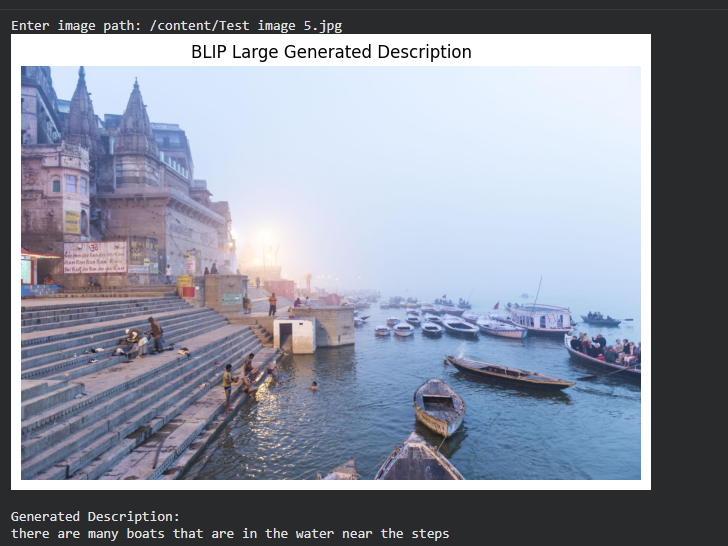

# Image-to-Text Description Generation Using BLIP

### Introduction

This project generates natural-language descriptions from images using
pretrained **BLIP (Bootstrapping Language-Image Pre-training)** models.

It implements and compares **BLIP Base** and **BLIP Large** using the MS
COCO 2017 Validation Dataset. Both models are used in pretrained form
without additional training or fine-tuning.

------------------------------------------------------------------------

### Models Used

-   [BLIP
    Base](https://huggingface.co/Salesforce/blip-image-captioning-base)
-   [BLIP
    Large](https://huggingface.co/Salesforce/blip-image-captioning-large)

### Dataset

**MS COCO 2017 Validation Dataset** contains 5,000 images with
human-written reference captions.

[Download dataset](https://cocodataset.org/#download)

------------------------------------------------------------------------

### Tech Stack

-   **Python** -- Main programming language.
-   **PyTorch** -- Executes the pretrained models.
-   **Hugging Face Transformers** -- Loads BLIP models and processors.
-   **Pillow (PIL)** -- Loads and prepares images.
-   **NLTK and ROUGE Score** -- Evaluate generated captions.
-   **Matplotlib** -- Displays images and results.
-   **Google Colab** -- Development environment.

------------------------------------------------------------------------

### Model Workflow

The flowchart shows how an input image is processed to generate a
description.

  

------------------------------------------------------------------------

## Sample Output

## Project Demonstration

**Click the thumbnail to watch the full project demonstration.**

------------------------------------------------------------------------

### Evaluation Results

The models are evaluated using BLEU-1, BLEU-2, BLEU-4, METEOR, and
ROUGE-L.

| Metric | BLIP Base | BLIP Large |
|---|---:|---:|
| BLEU-1 | 0.633 | 0.676 |
| BLEU-2 | 0.503 | 0.520 |
| BLEU-4 | 0.305 | 0.290 |
| METEOR | 0.424 | 0.528 |
| ROUGE-L | 0.538 | 0.539 |

BLIP Large scores higher on four metrics, while BLIP Base scores higher
on BLEU-4.

------------------------------------------------------------------------

### Prerequisites

-   Python
-   Google Colab or a local Python environment
-   PyTorch, Transformers, Pillow, NumPy, NLTK, and ROUGE Score
-   MS COCO 2017 Validation Dataset

------------------------------------------------------------------------

### Quick Start

1.  Open the project notebook in Google Colab.
2.  Install or import the required libraries.
3.  Load the MS COCO validation images and annotations.
4.  Run the notebook cells to load both BLIP models.
5.  Provide an image and generate its caption.
6.  Run the evaluation cells to compare the models.

------------------------------------------------------------------------

### Project Resources

-   **Dataset:** https://cocodataset.org/#download
-   **BLIP Base:**
    https://huggingface.co/Salesforce/blip-image-captioning-base
-   **BLIP Large:**
    https://huggingface.co/Salesforce/blip-image-captioning-large
-   **Demo Video:** https://youtu.be/0f6SnVhzlEM
-   **Project Report:** https://github.com/Shourya-Basu/Image-to-Text_Description_Generation

------------------------------------------------------------------------

